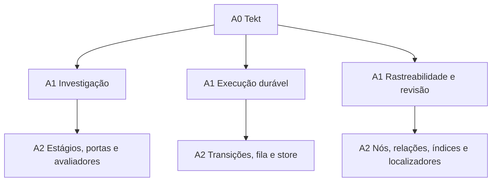

# ADR-0008 Hierarquia de arquiteturas sob Tekt

**Status**: DEFINIDO PARA EXPERIMENTO — conformidade da implementação ainda não demonstrada  
**Data**: 2026-10-06  
**Relacionado**: ADR-0002, ADR-0004, ADR-0007 e passo 0103

## Contexto

O Bateia investiga software para produzir oportunidades de reúso e insights de engenharia. Sua organização precisa acomodar descoberta, evidências, interpretação, hipóteses e decisão, preservando a arquitetura Tekt.

O código já contém uma jornada por estágios em `idea_run.go`, execução durável em `recommendation_run.go`, extração de mecanismos e síntese de hipóteses, além de grafos de rastreabilidade. Essas estruturas não possuem o mesmo escopo nem respondem às mesmas perguntas.

A existência de vários estilos não exige que cada capacidade seja uma arquitetura. Um contrato arquitetural precisa identificar elementos, relações, invariantes e fronteiras. Reúso e insights são capacidades; pipeline, máquina de estados e grafo são organizações candidatas para realizá-las.

## Decisão

Adotar três níveis de autoridade e refinamento, identificados por A0, A1 e A2. Esses níveis não substituem nem renumeram L0–L4. O prefixo A indica o escopo de uma decisão arquitetural; L indica a camada Tekt em que um artefato é materializado.

| Nível | Nome | Pergunta | Autoridade |
| --- | --- | --- | --- |
| A0 | Arquitetura governante | Que regras todo o programa deve respeitar? | Tekt governa todas as materializações produtivas |
| A1 | Arquitetura de subsistema | Como um recorte do programa organiza seus elementos e suas interações? | Especializa A0 dentro de um escopo explícito |
| A2 | Mecanismos de realização | Como cada parte realiza os contratos do subsistema? | Especializa A1 e preserva A0 |

A2 não é automaticamente uma terceira arquitetura. Portas, fila, regras de transição e armazenamento são mecanismos. Um mecanismo só deve receber uma arquitetura interna quando sua complexidade justificar um contrato próprio de elementos, relações e invariantes.

As setas significam governa/refina, não importa, chama ou precede na execução. Investigação e runtime cooperam por contratos; não há subordinação de negócio entre eles. O runtime não governa os critérios de reúso ou insights.

## A0 Tekt

As regras existentes permanecem aplicáveis:

- L0 conserva intenção, contratos, prompts, ADRs e sínteses declarativas.
- L1 conserva domínio, transformações e regras; efeitos são delegados por portas, sem I/O direto ou imports de L2/L3/L4.
- L2 adapta entrada e apresentação e não importa adaptadores concretos de L3.
- L3 realiza efeitos e implementa portas de L1; não importa L2/L4.
- L4 compõe e injeta dependências e coordena lifecycle; não decide política de negócio.
- O Lab contém experimentos e verificadores e não é dependência do produto.

Uma arquitetura local não concede exceções a essas regras. Conflito com A0 exige redesenho local ou uma decisão explícita sobre Tekt; um ADR de subsistema não pode silenciosamente revogar a gravidade.

## A1 Subsistemas iniciais

| ID | Subsistema | Organização candidata | Responsabilidade | Fronteira |
| --- | --- | --- | --- | --- |
| A1-INV | Investigação | Pipeline com retomada e ciclos de investigação explícitos | Transformar perguntas e fontes em evidências, análises, oportunidades de reúso e insights | Não possui fila, arquivos ou transporte; critérios específicos de cada resultado |
| A1-RUN | Execução durável | Máquina de estados com execução por fila | Admissão operacional, lifecycle, progresso, cancelamento e publicação de artefatos | Não escolhe conclusões de negócio nem interpreta evidências |
| A1-TRACE | Rastreabilidade e revisão | Grafo de relações registradas com projeções de revisão | Localizar declarações, relações e efeitos de alterações registradas | Não autentica fontes, comprova causalidade completa ou aprova conclusões |

São três contratos de organização dentro de um mesmo programa. Nenhum implica microserviços, processos separados, nova raiz de pastas ou uma cópia de L0–L4 por subsistema.

Descoberta, coleta, análise, reúso e insights começam como capacidades de A1-INV. Apresentação e adaptadores de provedores continuam com responsabilidades de camada. Novos subsistemas exigem ownership e invariantes próprios que justifiquem a separação.

## Realização nas camadas

| Subsistema | L1 | L2 | L3 | L4 |
| --- | --- | --- | --- | --- |
| Investigação | Tipos, planos, estágios, regras de evidência, análise, reúso e hipóteses | Entrada e projeções CLI/MCP | Busca, leitura de fontes e análise externa | Escolha e injeção dos provedores |
| Execução durável | Estado, transições, contratos de jobs, artefatos e serviço de execução | Comandos de iniciar, consultar e cancelar | Fila, IDs, store e container | Configuração e ordem de lifecycle |
| Rastreabilidade e revisão | Grafo, comparação, impacto, localizadores lógicos e regras de progresso | Leitura de pedidos e apresentação | Efeitos de leitura/persistência contratados, quando necessários | Composição das dependências exigidas |

A matriz define responsabilidades alvo. Não afirma que a árvore atual já atende a todas elas. Uma migração de I/O existente em L2 ou metadados temporais em L1 precisa de exegese, prompt e teste de preservação próprios.

## Regras de composição

1. Cada contrato local declara ID, nível, pai governante, escopo, responsável, elementos, relações, invariantes, entradas, saídas e critérios de verificação.
2. Um contrato tem um pai governante declarado; dependências entre subsistemas são relações adicionais. A árvore de autoridade e o grafo de colaboração são modelos diferentes.
3. Cada regra ou estado tem um proprietário. Outros subsistemas usam uma interface ou projeção; não reinterpretam nem alteram o estado por fora de seu contrato.
4. A investigação entrega resultado de negócio. O runtime registra estado de execução. Execução concluída pode produzir resultado inconclusivo; progresso concluído não equivale a hipótese validada.
5. Evidência e proveniência são compartilhadas por contratos explícitos. Reúso e insights aplicam critérios próprios; inelegibilidade para adoção não demonstra ausência de valor investigativo.
6. Um estágio pode solicitar nova investigação de maneira limitada e observável. A proposta não autoriza loops ilimitados nem modifica o pipeline atual.
7. Subsistemas atravessam camadas por portas e adaptadores compostos em L4. Pertencer ao mesmo subsistema não autoriza import proibido.
8. Grafos, vistas e estruturas de dados são classificados pelo seu contrato; a forma visual ou o uso de uma biblioteca não basta para declarar uma arquitetura.

## Mapeamento brownfield inicial

| Código existente | Contrato alvo | Questão a verificar |
| --- | --- | --- |
| `01_core/usecase/idea_run.go` e `recommendation.go` | A1-INV | Separação entre investigação compartilhada e decisão de reúso |
| `01_core/usecase/mechanism_extraction.go` | A1-INV | Evidência de mecanismo distinta de sua aplicabilidade ao alvo |
| `01_core/usecase/improvement_synthesis.go` | A1-INV e A1-RUN, a separar | Síntese/validação de hipóteses misturadas com resolução de artefatos e lifecycle |
| `01_core/usecase/recommendation_run.go` | A1-RUN e delegação para A1-INV | Serviço acumula configuração de mercado, extração, síntese e publicação |
| `03_infra/runcontainer`, `runworker` e `runstore` | Realização A2 de A1-RUN em L3 | Preservar ownership e lifecycle aceitos no ADR-0007 |
| `01_core/usecase/decision_trace*.go` | A1-TRACE | Relações registradas e revisão sem promoção factual |
| `04_wiring/*.go` | Composição das realizações | Evitar regras de negócio e dependência de detalhes internos |

## Experimento e consequências

O passo [0103](../passos/0103-testar-hierarquia-de-arquiteturas-sob-tekt.md) define a verificação da hierarquia antes de promover refatorações. A primeira entrega é o mapa de responsabilidades e conflitos; o segundo marco é uma fatia de implementação contratada separadamente. O experimento deve avaliar se a hierarquia melhora ownership e composição sem violar Tekt.

Nomes públicos e pacotes atuais permanecem até que um corte justifique sua mudança. A proposta acrescenta critérios de organização; não declara pureza já alcançada ou utilidade de insights já comprovada.

## Referência conceitual

Garlan e Shaw descrevem combinação hierárquica de estilos em [An Introduction to Software Architecture, seção 3.8](https://www.cse.msu.edu/~cse870/Materials/Design/intro_softarch-Garlan-Shaw.pdf). A hierarquia A0–A2 e seu mapeamento para Tekt são uma decisão deste experimento no Bateia, não uma taxonomia atribuída aos autores.

## Primeira materialização

O [mapa](../arquitetura/README.md) explicita organizações candidatas, propriedades e responsabilidades. O primeiro corte separa derivação de hipóteses e estado de negócio do protocolo de admissão, integridade de fontes e publicação. A classificação A1 continua hipótese de organização; a existência desses arquivos não comprova arquiteturas independentes. Consultar o passo 0103 para a avaliação restante.

## Admissão e apresentação de fontes

O [ADR-0009](ADR-0009-admissao-de-conectores-e-projecao-mcp.md) aplica a mesma divisão de responsabilidades ao registro de descoberta: L1 admite, L4 compõe e L2 apresenta as fontes efetivamente configuradas. Esse corte trata um conflito entre invariantes locais e composição; não reclassifica o registro como arquitetura independente.
