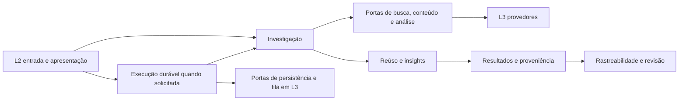

# Mapa de responsabilidades do Bateia

O Bateia investiga software para produzir reúso e insights de engenharia. Este mapa orienta uma mudança até seu proprietário, contrato e verificação. Tekt governa a localização dos artefatos; os escopos abaixo ajudam a compreender suas relações.

## Autoridade e classificação

[A0 Tekt](../ADR/ADR-0002-estrutura-de-pastas-e-camadas-tekt.md) governa todos os escopos. O [ADR-0008](../ADR/ADR-0008-hierarquia-de-arquiteturas-sob-tekt.md) define organizações locais candidatas A1 e mecanismos A2. A conformidade é verificada por fatias; o uso de pipeline, fila ou grafo não comprova uma arquitetura independente.

| Organização candidata | Escopo e invariantes | Situação |
| --- | --- | --- |
| Investigação | Estágios e contratos que ligam intenção, candidatos, evidências e conclusões; falha/ausência limitada não viram prova de inexistência | Jornada existente; vários critérios ainda ligados ao reúso |
| Execução durável | Estados, transições, idempotência, progresso, cancelamento e artefatos; sucesso operacional não é validação de hipótese | Runtime existente; acumula responsabilidades de investigação |
| Rastreabilidade e revisão | Grafo de relações registradas, localizadores e progresso declarado; revisão concluída não autentica fontes nem altera a decisão histórica | Capacidades existentes, com escopo consultivo |

A árvore A0–A2 registra autoridade. O fluxo abaixo registra colaboração; não representa imports Go.

No código, L1 declara as portas e L4 conecta as implementações. As setas de execução para L3 não autorizam import concreto de infraestrutura no core.

## Localização por responsabilidade

| Responsabilidade | Proprietário atual | Contrato inicial | Verificação principal |
| --- | --- | --- | --- |
| Intenção e expansão | `domain/idea_spec.go`, `usecase/idea_expander.go`, `semantic_expander.go` | Passos 0001/0002 e prompts proprietários | `idea_expander_test.go`, `semantic_expander_test.go` |
| Descoberta de código/projetos | `usecase/idea_discovery.go`, `project_catalog.go`, `market_discovery.go` | Passos 0003/0015/0027 | Testes dos casos de uso e conectores |
| Pesquisa acadêmica | `02_shell/cli/idea_research.go`, `03_infra/research/` | Prompts regularizados da CLI e conectores | `idea_research_test.go`, `research_test.go` |
| Registro configurado de descoberta | `usecase/market_registry.go` | [ADR-0009](../ADR/ADR-0009-admissao-de-conectores-e-projecao-mcp.md) e [passo 0104](../passos/0104-compor-descoberta-por-registro-validado.md) | `market_registry_test.go`, `04_wiring/market_composition_test.go` |
| Catálogo Bitbucket | `03_infra/bitbucket/connector.go` e composição de mercado | Prompt proprietário e workspaces configurados | `connector_test.go` |
| Triagem | `usecase/probabilistic_screening.go`, `screening_calibration.go` | Passo 0004 e prompts proprietários de calibração | Testes de triagem/calibração; consultar limitações do corpus |
| Evidência e recuperação | `usecase/evidence.go`, `evidence_authority.go`, `evidence_recovery.go` | Passos 0005–0010 e evoluções probatórias | Testes de identidade, integridade, incompletude e recuperação |
| Mecanismos observados | `usecase/mechanism_extraction.go` e `domain/architectural_mechanism.go` | Passo 0028; catálogo proprietário em L1 | `mechanism_extraction_test.go` e oráculos ativos |
| Piloto de observação de concorrência | `lab/bancada/concorrencia/0109` (regime Lab) | [Passo 0109](../passos/0109-observar-propriedades-de-concorrencia-no-lab.md) | Corpus autoral, controles e ensaio congelado; sem promoção produtiva |
| Vista documental ligada à observação | `lab/bancada/concorrencia/0121` (regime Lab) | [Passo 0121](../passos/0121-ligar-documentacao-a-evidencia-estatica.md) | AST, hashes, associações e preservação de v8; sem veredito contratual |
| Investigação offline de insights | `domain/insight_investigation.go`, `usecase/insight_investigation.go`, `02_shell/cli/idea_insights.go` | [ADR-0010](../ADR/ADR-0010-investigacao-offline-de-insights.md) e [passo 0105](../passos/0105-investigar-insights-sem-decisao-de-reuso.md) | Testes de domínio/caso de uso/CLI e [bancada](../../lab/bancada/insights/0105/README.md) |
| Análise de hipóteses | [improvement_analysis.go](../../01_core/usecase/improvement_analysis.go) | [Prompt da análise](../prompts/01_core/usecase/improvement_analysis.md) | [Teste de preservação](../../01_core/usecase/improvement_analysis_test.go) |
| Decisão de reúso e alternativas | `usecase/reuse_decision.go`, `software_alternative.go`, `recommendation.go` | Passos 0008/0024/0025 | Testes de decisão, alternativas e gateway |
| Protocolo de execução de síntese | [improvement_synthesis.go](../../01_core/usecase/improvement_synthesis.go) | [Prompt do protocolo](../prompts/01_core/usecase/improvement_synthesis.md) | Contratos de runs e síntese MCP, além da análise pura |
| Lifecycle e artefatos | `usecase/recommendation_run.go`, `domain/recommendation_run.go` | Passo 0026 e ADR-0007 | Contratos de runs, store, fila e wiring |
| Fila, store e container | `03_infra/runworker`, `runstore`, `runcontainer` | ADR-0007 e prompts proprietários | Testes dos adaptadores e lifecycle |
| Rastreabilidade e revisão | `usecase/decision_trace*.go`, `02_shell/cli/idea_trace.go` | Passos 0098–0102 | Testes do grafo, comparação, revisão e CLI |
| Composição e entrada | `04_wiring/` | Prompts L4 e ADRs de ownership | Testes de wiring; build do executável |

Caminhos abreviados `domain/` e `usecase/` pertencem a `01_core`. Antes de modificar, seguir o `@prompt` do arquivo; a tabela não substitui esse contrato. O mapa cobre as responsabilidades centrais do recorte, não todas as capacidades do repositório.

## Primeira separação implementada

A síntese passou a ter duas responsabilidades explícitas no mesmo pacote L1:

| Responsável | Recebe | Produz | Não possui |
| --- | --- | --- | --- |
| Análise pura | Pedido normalizado e mecanismos validados, com sinal de degradação | Comparações, hipóteses, lacunas, planos, proveniência e estado de negócio | Store, fila, serviço de runs, relógio ou lifecycle |
| Protocolo durável | Pedido, referências a artefatos e portas de execução | Admissão, resolução íntegra das fontes, transições e publicação | Decisão autônoma de promoção das hipóteses |

A separação é de arquivos e contratos dentro de `usecase`; não há isolamento por pacote Go. O resultado da análise tem campos nomeados e o runtime o publica sem redefinir suas conclusões. A projeção legada foi congelada antes da extração para verificar preservação de IDs, ordenação e conteúdo.

## Segunda separação implementada

A admissão do registro configurado pertence a L1 e exige fontes válidas, únicas e não vazias. L4 usa esse contrato sem contagem fixa. L2 projeta o registro recebido no schema MCP, inclusive com a extensão de síntese habilitada. A quantidade registrada e o limite de fontes selecionadas por pedido são conceitos diferentes; a seleção mantém o teto de dez.

O [ADR-0009](../ADR/ADR-0009-admissao-de-conectores-e-projecao-mcp.md) registra ownership e preservação. Os testes de composição usam as instâncias criadas pelas fábricas padrão/federada, verificam startup do construtor e respostas MCP offline e encerram/reabrem os mesmos recursos. Não carregam `.env` ou consultam as APIs remotas. O startup do binário padrão, com e sem Bitbucket configurado, também passou em ambiente isolado; consultar o [laudo 0104](../laudos/0104-composicao-por-registro-validado.md).

## Investigação independente de insights

`idea insights analyze` recebe pergunta, alvo, classes e fontes congeladas diretamente. L1 verifica integridade e usa o extrator ativo; L2 trata JSON estrito/saída protegida; L4 dispensa ambiente, caches e runtime. O relatório distingue mecanismo observado sob avaliações declaradas de hipótese de benefício no alvo. O plano propõe baseline, aplicabilidade e experimento sem executá-los. A licença declarada não funciona como filtro investigativo nem concede autorização de adoção.

O [ADR-0010](../ADR/ADR-0010-investigacao-offline-de-insights.md) limita esse recorte às quatro classes do catálogo ativo e explicita avaliações não refeitas. Nenhuma origem externa é autenticada automaticamente e o efeito no alvo permanece desconhecido.

## Fronteiras observadas e limites

- O runtime ainda configura descoberta, catálogo de mecanismos e síntese e coordena diversos tipos de run. Esta fatia não o transforma em executor genérico.
- O pipeline usa relógio em L1 e parsers também registram tempo. A intenção de pureza completa permanece pendente.
- A CLI conserva I/O de dossiê/checkpoints. Uma extração futura exige contrato de compatibilidade específico.
- A síntese durável anterior ainda consome artefatos de runs. O passo 0105 acrescenta uma jornada offline independente com fontes congeladas; a coleta pública e inspeção manual de uma fonte real passaram no [passo 0106](../passos/0106-corrigir-esperas-e-investigar-github.md). Busca automática nesta jornada e avaliação semântica automática continuam pendentes.
- Critérios de triagem e política de reúso não foram relaxados. Investigar se excluem fontes úteis para insights é trabalho próprio.
- O conflito de cardinalidade e o schema estático foram tratados no passo 0104. Configuração de ambiente/credenciais e consultas reais dos provedores continuam fora da verificação de composição offline.
- O ADR-0008 define classificações candidatas. O experimento atual comprova um corte de responsabilidades, não a validade universal dessa hierarquia ou ganho de produtividade da IA.

## Como planejar a próxima mudança

Declarar capacidade, responsável, camada, contrato, consumidores, observável, evidência e limites. Se uma função acumula proprietários, marcar o conflito e escolher um corte pequeno. Atualizar os prompts antes de implementar e registrar a síntese e o recorte de verificação no passo correspondente.
