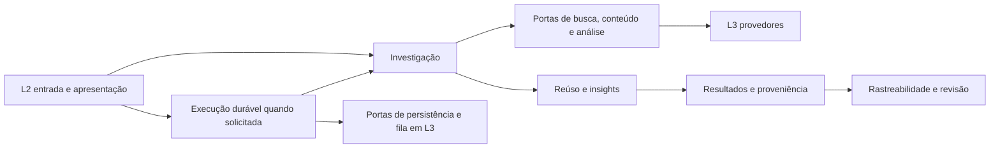

# Mapa de responsabilidades do Bateia

O Bateia investiga software para produzir reúso e insights de engenharia. Este mapa orienta uma mudança até seu proprietário, contrato e verificação. Tekt governa a localização dos artefatos; os escopos abaixo ajudam a compreender suas relações.

A prioridade atual de produto é a investigação de insights, conforme o [passo 0133](../passos/0133-priorizar-insights-de-engenharia.md), auxiliando a IA a ampliar seu repertório. Analyze/compare usam fontes congeladas, avaliações fornecidas e catálogo fechado; o [passo 0134](../passos/0134-conservar-observacoes-especificas-nos-insights.md) conserva observações específicas declaradas. O [passo 0136](../passos/0136-preparar-exploracao-criativa-para-ia.md) acrescenta exploração com trechos selecionados automaticamente e tarefas para IA, sem exigir avaliações ou classes de mecanismo. A seleção lexical/estrutural não comprova novidade ou utilidade.

## Autoridade e classificação

[A0 Tekt](../ADR/ADR-0002-estrutura-de-pastas-e-camadas-tekt.md) governa todos os escopos. O [ADR-0008](../ADR/ADR-0008-hierarquia-de-arquiteturas-sob-tekt.md) define organizações locais candidatas A1 e mecanismos A2. A conformidade é verificada por fatias; o uso de pipeline, fila ou grafo não comprova uma arquitetura independente.

| Organização candidata | Escopo e invariantes | Situação |
| --- | --- | --- |
| Investigação | Estágios e contratos que ligam intenção, candidatos, evidências e conclusões; falha/ausência limitada não viram prova de inexistência | Jornada existente; vários critérios ainda ligados ao reúso |
| Execução durável | Estados, transições, idempotência, progresso, cancelamento e artefatos; sucesso operacional não é validação de hipótese | Runtime existente; acumula responsabilidades de investigação |
| Rastreabilidade e revisão | Grafo de relações registradas, localizadores e progresso declarado; revisão concluída não autentica fontes nem altera a decisão histórica | Capacidades existentes, com escopo consultivo |

A árvore A0–A2 registra autoridade. O fluxo abaixo registra colaboração; não representa imports Go.

No código, L1 declara as portas e L4 conecta as implementações. As setas de execução para L3 não autorizam import concreto de infraestrutura no core.

## Localização por responsabilidade

| Responsabilidade | Proprietário atual | Contrato inicial | Verificação principal |
| --- | --- | --- | --- |
| Intenção e expansão | `domain/idea_spec.go`, `usecase/idea_expander.go`, `semantic_expander.go` | Passos 0001/0002 e prompts proprietários | `idea_expander_test.go`, `semantic_expander_test.go` |
| Descoberta de código/projetos | `usecase/idea_discovery.go`, `project_catalog.go`, `market_discovery.go` | Passos 0003/0015/0027 | Testes dos casos de uso e conectores |
| Pesquisa acadêmica | `02_shell/cli/idea_research.go`, `03_infra/research/` | Prompts regularizados da CLI e conectores | `idea_research_test.go`, `research_test.go` |
| Registro configurado de descoberta | `usecase/market_registry.go` | [ADR-0009](../ADR/ADR-0009-admissao-de-conectores-e-projecao-mcp.md) e [passo 0104](../passos/0104-compor-descoberta-por-registro-validado.md) | `market_registry_test.go`, `04_wiring/market_composition_test.go` |
| Catálogo Bitbucket | `03_infra/bitbucket/connector.go` e composição de mercado | Prompt proprietário e workspaces configurados | `connector_test.go` |
| Catálogos Gitee e AtomGit | `03_infra/forge/forges.go` e composição padrão/federada | [Passo 0126](../passos/0126-integrar-gitee-e-atomgit.md); portas de descoberta L1 | Testes L3 de protocolo, despacho global L1 e composição MCP |
| Parsing de manifestos e instante de coleta | `01_core/parser/manifest.go`, parsers específicos e coletores GitHub/local L3 | [ADR-0011](../ADR/ADR-0011-instante-de-coleta-explicito-nos-manifestos.md) e [passo 0128](../passos/0128-explicitar-instante-de-coleta-nos-manifestos.md) | Corpus de 49 tipos, determinismo, erros e preservação do instante na reanálise |
| Triagem | `usecase/probabilistic_screening.go`, `screening_calibration.go`, `screening_model_policy.go` | Passo 0004, perfil opt-in do passo 0130 e prompts proprietários | Testes de triagem/calibração e admissão do perfil; consultar limitações do corpus |
| Evidência e recuperação | `usecase/evidence.go`, `evidence_authority.go`, `evidence_recovery.go` | Passos 0005–0010 e evoluções probatórias | Testes de identidade, integridade, incompletude e recuperação |
| Mecanismos observados | `usecase/mechanism_extraction.go` e `domain/architectural_mechanism.go` | Passo 0028; catálogo proprietário em L1 | `mechanism_extraction_test.go` e oráculos ativos |
| Piloto de observação de concorrência | `lab/bancada/concorrencia/0109` (regime Lab) | [Passo 0109](../passos/0109-observar-propriedades-de-concorrencia-no-lab.md) | Corpus autoral, controles e ensaio congelado; sem promoção produtiva |
| Vista documental ligada à observação | `lab/bancada/concorrencia/0121` (regime Lab) | [Passo 0121](../passos/0121-ligar-documentacao-a-evidencia-estatica.md) | AST, hashes, associações e preservação de v8; sem veredito contratual |
| Investigação offline de insights | `domain/insight_investigation.go`, `usecase/insight_investigation.go`, `02_shell/cli/idea_insights.go` | [ADR-0010](../ADR/ADR-0010-investigacao-offline-de-insights.md) e [passo 0105](../passos/0105-investigar-insights-sem-decisao-de-reuso.md) | Testes de domínio/caso de uso/CLI e [bancada](../../lab/bancada/insights/0105/README.md) |
| Observações específicas de fontes (v2) | `domain/source_insight.go`, `usecase/source_insight.go`, `02_shell/cli/idea_insights.go` | [ADR-0015](../ADR/ADR-0015-observacoes-localizadas-na-investigacao-de-insights.md) e [passo 0134](../passos/0134-conservar-observacoes-especificas-nos-insights.md) | Testes puros, CLI e [replay com fonte congelada](../../lab/bancada/insights/0134/README.md) |
| Comparação com baseline do alvo | `domain/insight_comparison.go`, `usecase/insight_baseline.go`, `usecase/insight_comparison.go`, CLI de insights | [ADR-0016](../ADR/ADR-0016-baseline-de-conteudo-na-comparacao-de-insights.md) e [passo 0135](../passos/0135-comparar-insights-com-baseline-do-alvo.md) | Testes puros/CLI e [caso comparativo congelado](../../lab/bancada/insights/0135/README.md) |
| Contexto de exploração para IA | `domain/insight_exploration.go`, `usecase/insight_exploration.go`, `usecase/insight_passages.go`, `02_shell/cli/insight_exploration.go` | [ADR-0017](../ADR/ADR-0017-contexto-de-exploracao-para-ia.md) e [passo 0136](../passos/0136-preparar-exploracao-criativa-para-ia.md) | Testes puros/CLI e [corpus congelado](../../lab/bancada/insights/0136/README.md) |
| Descoberta diversificada para insights | `domain/insight_discovery.go`, `usecase/insight_discovery_plan.go`, `insight_discovery.go`, `insight_discovery_selection.go`, `insight_reference_collection.go`, CLI de descoberta de insights | [ADR-0018](../ADR/ADR-0018-descoberta-diversificada-e-coleta-limitada-para-insights.md) e [passo 0137](../passos/0137-descobrir-referencias-diversificadas-automaticamente.md) | Testes puros/CLI, integração HTTP L3, despacho L4 e [ensaio público](../../lab/bancada/insights/0137/README.md) |
| Descoberta de insights entre sítios | `domain/insight_sites.go`, `usecase/insight_site_plan.go`, `insight_site_connectors.go`, `insight_site_candidates.go`, `insight_sites.go`; factory `04_wiring/insight_sites.go` | [ADR-0019](../ADR/ADR-0019-descoberta-de-insights-com-identidade-por-sitio.md) e [passo 0138](../passos/0138-ampliar-descoberta-de-insights-para-outros-sitios.md) | Testes puros/CLI, conectores Gitee/AtomGit com transporte de fixture, composição e [ensaio](../../lab/bancada/insights/0138/README.md) |
| Leitura de README por forge | `domain/insight_site_reading.go`, `usecase/insight_site_reading.go`, `03_infra/forge/insight_reader.go`, `public_insight_reader.go`; composição em `04_wiring/insight_sites.go` | [ADR-0020](../ADR/ADR-0020-leitura-de-readme-com-contexto-por-sitio.md) e [passo0139](../passos/0139-ler-readmes-de-gitee-e-atomgit.md) e [0140](../passos/0140-ler-readmes-de-codeberg-e-gitlab.md) | Identidade por sítio, SHA fixado, limites/erros, integração HTTP Gitee/AtomGit/Codeberg/GitLab e composição; [bancada](../../lab/bancada/insights/0140/README.md) |
| Oportunidades por perspectiva e trilhas documentais | `domain/insight_possibilities.go`, `usecase/insight_site_schedule.go`, `insight_reference_leads.go` | [Passo0141](../passos/0141-ampliar-possibilidades-com-perspectivas-e-trilhas.md); políticas e derivação em L1 | Permutação/budgets, testemunhos de links e [replay congelado](../../lab/bancada/insights/0141/README.md) |
| Memória e aprofundamento de trilhas | `domain/insight_exploration_memory.go`, `usecase/insight_exploration_memory.go`, `insight_followups.go`; CLI `insight_memory.go`; GitHub `insight_reference_resolver.go` | [ADR-0021](../ADR/ADR-0021-memoria-de-exploracao-e-aprofundamento-limitado.md) e [passo0142](../passos/0142-aprofundar-trilhas-e-conservar-memoria.md) | Duas rodadas, feedback, quotas, resolução pública e [replay](../../lab/bancada/insights/0142/README.md) |
| Expansão de vizinhanças sob demanda | `domain/insight_neighborhood.go`, `usecase/insight_neighborhood.go`, `insight_neighborhood_frontier.go`; CLI `insight_neighborhood.go`; leitores/factory existentes | [Passo0143](../passos/0143-expandir-vizinhancas-a-partir-da-memoria.md); foco e fronteira em L1, transporte L2, efeitos L3 e composição L4 | Continuação sem catálogo/nova pergunta, foco, documentos congelados, feedback, quotas e [bancada0143](../../lab/bancada/insights/0143/README.md) |
| Análise de hipóteses | [improvement_analysis.go](../../01_core/usecase/improvement_analysis.go) | [Prompt da análise](../prompts/01_core/usecase/improvement_analysis.md) | [Teste de preservação](../../01_core/usecase/improvement_analysis_test.go) |
| Decisão de reúso e alternativas | `usecase/reuse_decision.go`, `software_alternative.go`, `alternative_target.go`, `recommendation.go` | Passos 0008/0024/0025/0130 | Testes de decisão, alternativas, hints de alvo e gateway |
| Elegibilidade e diagnóstico de checkpoint de evidência | `usecase/evidence_checkpoint.go`; apresentação em `02_shell/cli/resume_diagnostic.go` | [ADR-0013](../ADR/ADR-0013-regras-de-alternativas-e-retomada-em-l1.md), [passo 0130](../passos/0130-extrair-regras-de-alternativas-e-retomada.md) e [0132](../passos/0132-explicar-retomada-de-evidencias.md) | Matriz pura de causalidade/artefatos, precedência dos motivos, privacidade e contratos CLI de retomada |
| Resolução íntegra das fontes de síntese | [improvement_sources.go](../../01_core/usecase/improvement_sources.go) | [Prompt do resolvedor](../prompts/01_core/usecase/improvement_sources.md) e [passo 0127](../passos/0127-separar-resolucao-de-fontes-da-sintese.md) | Caracterização de fontes, análise e falhas em `improvement_sources_test.go`; porta interna de leitura |
| Protocolo de execução de síntese | [improvement_synthesis.go](../../01_core/usecase/improvement_synthesis.go) | [Prompt do protocolo](../prompts/01_core/usecase/improvement_synthesis.md) | Contratos de runs e síntese MCP, além da análise pura |
| Jornada do dossiê e identidade causal | `usecase/recommendation_dossier.go`, `recommendation_dossier_artifacts.go` | [ADR-0014](../ADR/ADR-0014-jornadas-de-investigacao-e-gate-reproduzivel.md) e [passo 0131](../passos/0131-concluir-divergencias-da-revisao-tekt.md) | Contratos CLI preservados e jornada com porta em memória |
| Investigação web observável e experimental | `usecase/web_experiment_run.go` | Contratos 0018–0020 preservados no recorte 0131 | Intercalação, admissão, budget, retomada, hashes e veredicto |
| Investigação de mercado | `usecase/market_execution.go` | Porta `ObservableMarketDiscoveryExecutor` e contrato 0131 | Executor configurado, budget, normalização e lacunas; composição MCP |
| Lifecycle e artefatos | `usecase/recommendation_run.go`, `domain/recommendation_run.go` | Passo 0026 e ADR-0007 | Contratos de runs, store, fila e wiring |
| Fila, store e container | `03_infra/runworker`, `runstore`, `runcontainer` | ADR-0007 e prompts proprietários | Testes dos adaptadores e lifecycle |
| Rastreabilidade e revisão | `usecase/decision_trace*.go`, `02_shell/cli/idea_trace.go` | Passos 0098–0102 | Testes do grafo, comparação, revisão e CLI |
| Relógio e deadlines | `domain/execution_runtime.go`, `usecase/recommendation_runtime.go` | [ADR-0012](../ADR/ADR-0012-portas-de-execucao-e-arquivos.md) | Testes de runtime explícito, duração e descoberta |
| Arquivos e captura local | `domain/command_files.go`, `local_workspace.go`, `03_infra/host/` | Portas estreitas de armazenamento, exports, trace, workspace e ambiente | Testes L3 e integração CLI: quotas, aliases, identidade, bytes congelados, atomicidade e cleanup |
| Configuração de capacidades duráveis | `usecase/run_capabilities.go` | Containers internos de mercado, extração e síntese; um lifecycle | `run_capabilities_test.go`, contratos de runs/MCP |
| Composição e entrada | `04_wiring/` | Prompts L4 e ADRs de ownership | Testes de wiring; build do executável |

Caminhos abreviados `domain/` e `usecase/` pertencem a `01_core`. Antes de modificar, seguir o `@prompt` do arquivo; a tabela não substitui esse contrato. O mapa cobre as responsabilidades centrais do recorte, não todas as capacidades do repositório.

## Primeira separação implementada

A síntese passou a ter duas responsabilidades explícitas no mesmo pacote L1:

| Responsável | Recebe | Produz | Não possui |
| --- | --- | --- | --- |
| Análise pura | Pedido normalizado e mecanismos validados, com sinal de degradação | Comparações, hipóteses, lacunas, planos, proveniência e estado de negócio | Store, fila, serviço de runs, relógio ou lifecycle |
| Protocolo durável | Pedido, referências a artefatos e portas de execução | Admissão, delegação da resolução íntegra, transições e publicação | Decisão autônoma de promoção das hipóteses |

A separação é de arquivos e contratos dentro de `usecase`; não há isolamento por pacote Go. O resultado da análise tem campos nomeados e o runtime o publica sem redefinir suas conclusões. A projeção legada foi congelada antes da extração para verificar preservação de IDs, ordenação e conteúdo.

## Segunda separação implementada

A admissão do registro configurado pertence a L1 e exige fontes válidas, únicas e não vazias. L4 usa esse contrato sem contagem fixa. L2 projeta o registro recebido no schema MCP, inclusive com a extensão de síntese habilitada. A quantidade registrada e o limite de fontes selecionadas por pedido são conceitos diferentes; a seleção mantém o teto de dez.

O [ADR-0009](../ADR/ADR-0009-admissao-de-conectores-e-projecao-mcp.md) registra ownership e preservação. Os testes de composição usam as instâncias criadas pelas fábricas padrão/federada, verificam startup do construtor e respostas MCP offline e encerram/reabrem os mesmos recursos. Não carregam `.env` ou consultam as APIs remotas. O startup do binário padrão, com e sem Bitbucket configurado, também passou em ambiente isolado; consultar o [laudo 0104](../laudos/0104-composicao-por-registro-validado.md).

## Resolução de fontes separada do lifecycle

O corte [0127](../passos/0127-separar-resolucao-de-fontes-da-sintese.md) extrai `improvement_sources.go` do protocolo durável. Seu proprietário resolve runs e artefatos congelados, verifica identidade/hash e paginação, interpreta mecanismos/lacunas/observações e valida referências das propostas. Recebe somente `synthesisArtifactReader` (`Get` e `ReadArtifact`), sem dependência do serviço de execução.

O protocolo em `improvement_synthesis.go` chama a mesma resolução antes de reservar fila e durante a execução; conserva normalização, hash causal, idempotência, transições e publicação. A análise em `improvement_analysis.go` recebe os mecanismos validados e o sinal de degradação. Os três componentes permanecem em L1 e no pacote `usecase`; a separação limita a dependência do resolvedor, sem criar outro runtime. As regras de leitura não autenticam a origem externa nem comprovam hipóteses.

## Investigação independente de insights

`idea insights analyze` recebe pergunta, alvo, classes e fontes congeladas diretamente. L1 verifica integridade e usa o extrator ativo; L2 trata JSON estrito/saída protegida; L4 dispensa ambiente, caches e runtime. O relatório distingue mecanismo observado sob avaliações declaradas de hipótese de benefício no alvo. O plano propõe baseline, aplicabilidade e experimento sem executá-los. A licença declarada não funciona como filtro investigativo nem concede autorização de adoção.

O [ADR-0010](../ADR/ADR-0010-investigacao-offline-de-insights.md) limita esse recorte às quatro classes do catálogo ativo e explicita avaliações não refeitas. Nenhuma origem externa é autenticada automaticamente e o efeito no alvo permanece desconhecido.

Na versão 2, `source_insight.go` em L1 valida, canonicaliza e localiza observações fornecidas, projeta análises por fonte/classe e deriva condições operacionais nas hipóteses. Reutiliza a classificação v1 sobre cópia sem observações, preservando os mecanismos originais. L2 seleciona o contrato pela versão da entrada e conserva a publicação protegida. `source_analyses` separa catálogo, escopo do extrator e observações `DECLARED_NOT_REASSESSED`; referências corretas não promovem seu significado. O [ADR-0015](../ADR/ADR-0015-observacoes-localizadas-na-investigacao-de-insights.md) delimita esse contrato.

`idea insights compare` delega a investigação v2 e acrescenta baseline de conteúdo do alvo. `insight_baseline.go` possui hashes/quotas/observações do snapshot e `insight_comparison.go` possui agrupamento consultivo e próximos passos. L2 conserva transporte; não há novo efeito ou runtime. O digest do snapshot não é commit e o agrupamento por classe/tipo não determina equivalência semântica ou benefício ([ADR-0016](../ADR/ADR-0016-baseline-de-conteudo-na-comparacao-de-insights.md)).

`idea insights explore` recebe pergunta/familiaridade e uma lista opcional de bundles, sem assessments/observations. `insight_exploration.go` possui normalização, identidade e tarefas; `insight_passages.go` possui janelas, seleção e diagnósticos de variedade. L2 adapta flags/leitura/saída protegida. Não chama modelo, busca ou fonte externa; não depende do catálogo de mecanismos e não classifica novidade. O [ADR-0017](../ADR/ADR-0017-contexto-de-exploracao-para-ia.md) delimita sua responsabilidade como contexto para interpretação pela IA.

`idea insights discover` é o ramo online explícito: plano lexical e budgets em `insight_discovery_plan.go`; execução por portas, recibos e contexto em `insight_discovery.go`; união/seleção em `insight_discovery_selection.go`; política de README em `insight_reference_collection.go`. L2 publica resultados completos/parciais com proteção, L3 usa o cliente GitHub existente e L4 injeta suas portas antes do despacho offline. Não há novo runtime durável, política de reúso ou cliente concreto em L1/L2. O [ADR-0018](../ADR/ADR-0018-descoberta-diversificada-e-coleta-limitada-para-insights.md) conserva limites de identidade e de evidência.

Com `--sources`, o plano multifonte é admitido por `insight_site_plan.go`, as bridges reaproveitam portas GitHub/Sourcegraph, `insight_site_candidates.go` possui identidade/seleção e `insight_sites.go` executa as células fonte×query. A factory lazy L4 reutiliza os conectores federados sem alterar o registro de mercado. Identidade por sítio, orçamento global e separação entre metadados e bytes estão no [ADR-0019](../ADR/ADR-0019-descoberta-de-insights-com-identidade-por-sitio.md); nenhuma forge é interpretada como GitHub por compartilhar owner/repo.

## Fronteiras observadas e limites

- O [passo 0130](../passos/0130-extrair-regras-de-alternativas-e-retomada.md) retira da CLI três decisões: remapeamento consultivo do alvo local antes do ranking, admissão semântica do perfil de screening opt-in e elegibilidade de checkpoint. L2 conserva JSON estrito, mensagens, hashes dos bytes e adapta os leitores restritos de L1 às portas existentes. A política de retomada escolhe em L1 os caminhos lógicos permitidos e controla ordem/short-circuit das leituras; nenhuma raiz física entra no núcleo.
- O [passo 0131](../passos/0131-concluir-divergencias-da-revisao-tekt.md) conclui os pontos da revisão: jornada/identidade/manifesto do dossiê e investigação/veredicto web em L1; L2 adapta transporte e apresentação. O executável injeta o serviço em L4, e a API CLI compatível usa a mesma jornada L1. A seleção de regras dinâmicas ocorre no núcleo, sem reconstruir o orquestrador na casca.
- O [passo 0129](../passos/0129-concluir-fronteiras-arquiteturais.md) conclui as fronteiras de efeitos inventariadas: L1 recebe relógio/deadline por porta; L3 possui arquivos, ambiente, sinais, entropia, hash/cópia e publicação física. L2 conserva entrada, apresentação e validação de transporte; L4 injeta o host no executável.
- Configuração de descoberta, extração e síntese possui containers próprios em `run_capabilities.go`. A investigação de mercado é delegada à porta configurada, com a mesma implementação L1 no caminho compatível. O serviço durável mantém store/fila/CAS/lifecycle e publica artefatos. A composição usa fábrica validada do extrator, sem executar investigação fictícia para validar configuração.
- `CommandHost` agrega portas menores, sem os.File/os.Root/syscall. Não há fallback concreto em L1/L2. Uso de biblioteca da CLI requer `ConfigureCommandHost`; metadado sem relógio é desconhecido, e deadline sem runtime é erro. O seam global da CLI é configurado somente no startup.
- Testes de transporte/parse foram transferidos para os adaptadores L3; composição e lifecycle continuam em L4. Uma composição externa de teste em `cli_test` instala o host para os contratos ativos da CLI e não integra o build produtivo.
- O gate canônico é `make verify`, com `make lint` para o lint isolado. Fonte, revisão, patch e hashes da ferramenta estão em `lab/ferramentas/crystalline-lint`; o runner não depende de clone externo e preserva regras/severidades e controles negativos. A auditoria cobre 387 arquivos produtivos no recorte 0142; o gate de ownership verifica os cortes desta revisão e recusa material não declarado em L0. Testes puros e auditores gerais foram retirados de L4; resultados Clang preservam bytes no Lab.
- A síntese durável anterior ainda consome artefatos de runs. O passo 0105 acrescenta uma jornada offline independente com fontes congeladas; a coleta pública e inspeção manual de uma fonte real passaram no [passo 0106](../passos/0106-corrigir-esperas-e-investigar-github.md). Os passos 0137/0138 acrescentam busca/coleta inicial GitHub e pesquisa nos conectores federados. O passo0139 acrescenta resolução/leitura imutável Gitee/AtomGit, em contextos com origem própria, sem mudar CommitRef global. O passo0140 acrescenta Codeberg/GitLab e preserva namespace com subgrupo; apenas esse contexto usa seleção pura de passagens com Source selado pela identidade validada, sem alterar o normalizador legado. Avaliação semântica e disponibilidade de cada serviço continuam dependências externas; outras fontes permanecem em catálogo.
- Critérios de triagem e política de reúso não foram relaxados. Investigar se excluem fontes úteis para insights é trabalho próprio.
- O conflito de cardinalidade e o schema estático foram tratados no passo 0104. Configuração de ambiente/credenciais e consultas reais dos provedores continuam fora da verificação de composição offline.
- O ADR-0008 define classificações candidatas. O experimento atual comprova um corte de responsabilidades, não a validade universal dessa hierarquia ou ganho de produtividade da IA.

## Organização atual da exploração

O [contrato consolidado de exploração v1](../contratos/exploracao-de-vizinhancas-v1.md) reúne as regras vigentes de memória, foco, aliases, leitura e resultado. A [matriz de aceitação](../contratos/exploracao-de-vizinhancas-aceitacao-v1.md) liga observáveis aos consumidores e explicita lacunas; o [passo0146](../passos/0146-consolidar-prompts-de-exploracao.md) registra a consolidação posterior ao código, sem alterar a história0142–0145. Para evoluir os prompts, consultar o [guia](../documentacao/escrever-prompts.md). O [passo0147](../passos/0147-corrigir-limites-e-verificar-contratos-de-exploracao.md) coloca a guarda de avanço no container L1 de memória e a compartilha entre feedback/discover/expand, preservando a inspeção do último snapshot válido.

O [passo0145](../passos/0145-reorganizar-fronteiras-de-investigacao-sob-tekt.md) reorganiza os responsáveis após0142–0144. As funções públicas e os formatos permanecem; os cortes separam invariantes que evoluem por motivos diferentes.

| Responsável em L1 | Proprietário em usecase | Fronteira |
| --- | --- | --- |
| Fachada de expansão | `insight_neighborhood.go` | Coordena portas/deadline e delega admissão, fronteira, execução e resultado |
| Admissão e limites | `insight_neighborhood_plan.go` | Valida/copia o pedido e entrega as origens congeladas já verificadas; não chama provedores |
| Integridade das fontes congeladas | `insight_neighborhood_sources.go` | Identidade, recibo, bytes e fingerprint; não percorre grafo nem seleciona destinos |
| Fronteira e distâncias | `insight_neighborhood_frontier.go` | Derivação de referências e travessia limitada; não executa leituras |
| Aliases e vista dos vizinhos | `insight_neighborhood_selection.go` | Relações conservadoras e snapshot consultivo, sem mudar o estado armazenado |
| Memória e invariantes de estado | `insight_exploration_memory.go` | Snapshot, bootstrap, feedback, testemunhos e contadores |
| Ordem compartilhada | `insight_followup_selection.go` | Elegibilidade e prioridades, sem efeitos ou mutação de memória |
| Execução de leituras | `insight_followups.go` | Quotas, deadlines e chamadas às portas, sem possuir o seletor de cartões |
| Contexto dos destinos lidos | `insight_followup_context.go` | Cartões atuais por identidade, sob quota compartilhada |
| Resultado da expansão | `insight_neighborhood_result.go` | Projeções, tarefas, estado operacional e selo, sem efeitos concretos |

L2 conserva JSON/flags/publicação; `web_input.go` possui o probe histórico de --no-token antes da composição. L3 conserva leitores e efeitos. L4 somente consulta o probe e injeta os clientes. A guarda de ownership reside no Lab e integra make verify; não pertence ao executável. Descoberta e expansão compartilham as mesmas políticas anteriores, sem reinterpretar estado operacional como força de evidência.

## Como planejar a próxima mudança

Declarar capacidade, responsável, camada, contrato, consumidores, observável, evidência e limites. Se uma função acumula proprietários, marcar o conflito e escolher um corte pequeno. Atualizar os prompts antes de implementar e registrar a síntese e o recorte de verificação no passo correspondente.

O [passo0153](../passos/0153-ligar-coleta-a-revisao-de-alternativas.md) acrescenta coordenação opt-in de coleta e exploração em `usecase/insight_collection.go`, sem efeitos concretos no núcleo. O pedido de exploração admite revisão de alternativas com múltiplas passagens por arquivo sob o teto global; modos históricos permanecem. L2 apenas adapta flags e publica o envelope.

O [passo0154](../passos/0154-corrigir-descoberta-nativa-e-testar-sem-memoria.md) acrescenta política contextual de descoberta em L1, padrão explícito da CLI L2. O catálogo GitHub L3 aceita escopo de metadados e resolução adiada; a coordenação L1 fixa identidades selecionadas pela porta existente antes de ler. Seleção lexical precede diversidade, sem classificar relevância semântica. Pedidos históricos sem política e a reprodução lexical-v1 permanecem.

O [passo0155](../passos/0155-descobrir-principios-e-decisoes-no-xerj.md) acrescenta raciocínio aberto sobre algoritmos em `domain/algorithm_insight.go` e `usecase/algorithm_insight.go` (L1). O modo de exploração prepara a cadeia observação→princípio→condições→alvo→decisão→experimento; formulate valida registros declarados contra bytes de fonte/alvo, sem catálogo fechado ou modelo interno. L2 usa entrada estrita e publicação existente, sem novas portas L3. Integridade do vínculo não promove interpretação, novidade ou efeito.

O [passo0158](../passos/0158-validar-origem-e-estabilizar-bundles.md) fecha a admissão de schemas e o vínculo entre extração e repo@commit em L1. O [contrato de coleta e serialização](../contratos/coleta-e-serializacao-de-evidencias-v1.md) delimita novas projeções estáveis de cobertura vazia e preservação de registros/hashes já emitidos.
