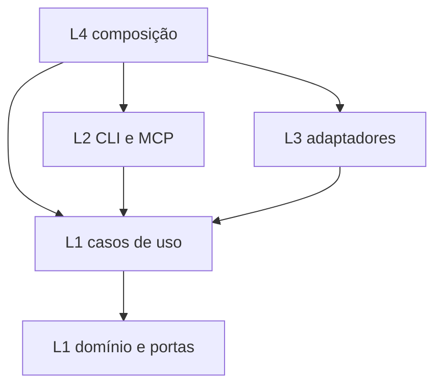
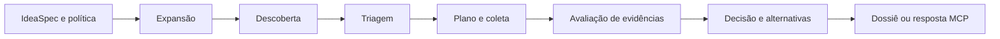

# Arquitetura atual do Bateia

O Bateia é um programa Go composto em `04_wiring`, com interfaces CLI, TUI e MCP, casos de uso em `01_core` e adaptadores em `03_infra`. O módulo raiz é `bateia`; `go.mod` declara Go 1.25.0. A separação Tekt organiza causa declarativa, regras, interação, efeitos e composição.

## Organização por contratos

O [mapa de responsabilidades](../arquitetura/README.md) conecta capacidade, arquivo, contrato e teste sob Tekt. A primeira fatia separa análise de insights do protocolo durável de síntese, dentro de L1. Reúso e insights possuem responsabilidades de negócio distintas; organizações locais continuam candidatas sujeitas à avaliação do ADR-0008.

## Responsabilidades e dependências

| Camada | Componentes | Responsabilidade |
| --- | --- | --- |
| L0 | Desejos, passos, prompts, ADRs, laudos e sínteses | Declarar intenção e explicar decisões; sem execução |
| L1 | `domain`, `parser`, `usecase` | Tipos, contratos, transformação e decisões; efeitos delegados a interfaces |
| L2 | `cli`, `mcp`, `report` | Entrada, validação de transporte, projeção e apresentação |
| L3 | Clientes, cache, coleta local, configuração, stores e workers | Implementar efeitos e integrações |
| L4 | `main.go` e fachadas de composição | Escolher implementações, injetar dependências e coordenar lifecycle |
| Lab | Gates, corpora e acervo histórico | Verificar e experimentar fora das dependências do produto |

As setas representam dependências de código. A execução de um caso de uso pode chamar um adaptador por uma porta de L1; isso não exige importar o pacote concreto de L3. L0 fornece especificações e rastreabilidade documental, não um módulo de execução. O Lab não é uma dependência do produto.

## Jornada principal de recomendação

[RunIdeaPipeline](../../01_core/usecase/idea_run.go) coordena expansão, descoberta, triagem, coleta, avaliação e decisão. Recebe provedores, regras e modelo por `IdeaRunDependencies`. Os modos live, local e replay selecionam a origem dos candidatos e da evidência.

[RecommendationService](../../01_core/usecase/recommendation.go) valida o gateway de recomendação, aplica a jornada e projeta alternativas. A [CLI de recomendação](../../02_shell/cli/idea_recommend.go) trata arquivos, snapshots locais, checkpoints, hashes e escrita do dossiê. O [servidor MCP](../../02_shell/mcp/server.go) recebe mensagens JSON-RPC pelo transporte stdio e usa serviços injetados. As opções e os formatos de CLI e MCP possuem contratos próprios; não se deve presumir equivalência integral.

O [SearchFunnel](../../01_core/usecase/funnel.go) é outra fachada: busca, leitura de manifestos/árvores e extração, com cache e análise semântica opcional. Sustenta comandos de busca/análise; sua saída não substitui a decisão de reúso da jornada principal.

## Portas e adaptadores

| Porta ou contrato de L1 | Uso | Implementação/composição |
| --- | --- | --- |
| `SearchProvider` | Busca do funil | Sourcegraph |
| `ObservableDiscoveryProvider` | Descoberta com tentativas observáveis | Sourcegraph na recomendação composta em `main.go` |
| `ContentProvider` | Manifestos, árvore, arquivos e metadados | GitHub, coleta local e router de conteúdo |
| `CacheStore` | Reutilização de resultados do funil | Bleve com fallback para disco |
| `SemanticProvider` | Análise estática opcional | Clang |
| `MarketDiscoveryConnector` | Descoberta federada de catálogos | Conectores injetados no runtime de mercado |
| Contratos de runs | Execução e acesso a artefatos duráveis | `runstore`, `runworker` e `runcontainer` |

Consulte [interfaces do domínio](../../01_core/domain/interfaces.go), [composição principal](../../04_wiring/main.go) e [composição de mercado](../../04_wiring/market_discovery.go).

Os conectores disponíveis variam com a composição. Existem funções de registro padrão e federado; algumas entradas são `CapabilityOnlyConnector`, que declaram capacidades sem constituir um cliente de busca. A presença de um pacote ou registro não demonstra sua ativação em toda jornada. Pesquisa acadêmica e Bitbucket integram mudanças locais presentes nesta leitura; Bitbucket depende de workspaces configurados.

## Persistência e lifecycle

O cache do funil, o dossiê da CLI e os artefatos das execuções MCP têm papéis distintos. Checkpoints usam entradas causais e hashes para validar reaproveitamento; um arquivo remanescente no disco não pertence automaticamente ao manifest de uma execução atual.

O [container durável](../../03_infra/runcontainer/container.go) possui store, fila e serviço. L4 configura e injeta funcionalidades, chama `Recover` antes de `Start` e entrega o encerramento ao container. `Shutdown` drena a fila antes de fechar o store. Essa divisão está aceita no [ADR-0007](../ADR/ADR-0007-container-de-runtime-duravel-em-l3.md); configuração durável pertence a L3 pelo [ADR-0005](../ADR/ADR-0005-configuracao-duravel-em-l3.md).

## Diferenças entre intenção e implementação

As regras pedem núcleo puro. A implementação consulta `time.Now` e `time.Since` na jornada e `time.Now` em parsers; há também concorrência e estado no funil. Portanto, delegar I/O aos adaptadores não torna todo L1 funcionalmente puro. Uma convergência futura deve separar transformação, metadados temporais e orquestração por um contrato explícito.

L2 realiza I/O de entrada/saída, inclusive persistência do dossiê. Extrair essa responsabilidade para uma porta e um adaptador é uma possibilidade de engenharia a avaliar, não uma decisão arquitetural já aceita.

L4 contém despacho e validação de configuração, além da composição. A revisão deve distinguir política de negócio de configuração e lifecycle antes de mover funções. A estratégia de convergência por fatias está no [ADR-0004](../ADR/ADR-0004-lab-e-contencao-brownfield.md).
