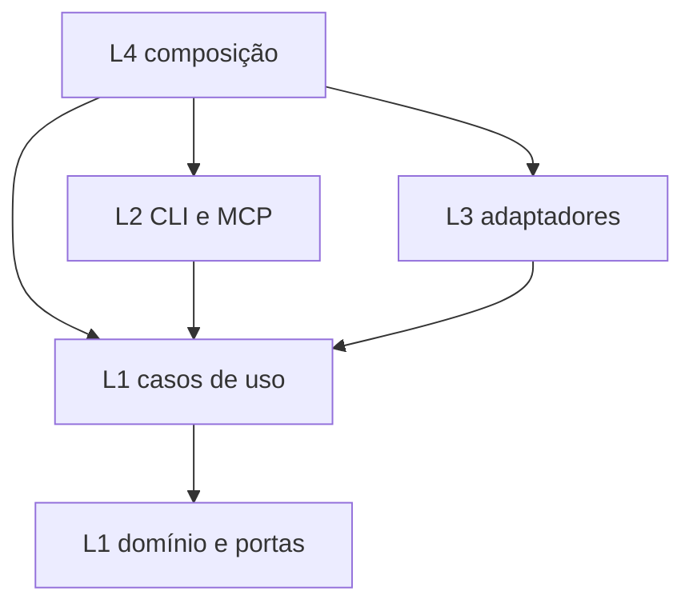
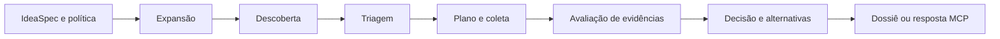

# Arquitetura atual do Bateia

O Bateia é um programa Go composto em `04_wiring`, com interfaces CLI, TUI e MCP, casos de uso em `01_core` e adaptadores em `03_infra`. O módulo raiz é `bateia`; `go.mod` declara Go 1.25.0. A separação Tekt organiza causa declarativa, regras, interação, efeitos e composição.

## Organização por contratos

O [mapa de responsabilidades](../arquitetura/README.md) conecta capacidade, arquivo, contrato e teste sob Tekt. A primeira fatia separa análise de insights do protocolo durável de síntese, dentro de L1. Reúso e insights possuem responsabilidades de negócio distintas; organizações locais continuam candidatas sujeitas à avaliação do ADR-0008.

## Responsabilidades e dependências

| Camada | Componentes | Responsabilidade |
| --- | --- | --- |
| L0 | Desejos, passos, prompts, ADRs, laudos e sínteses | Declarar intenção e explicar decisões; sem execução |
| L1 | `domain`, `parser`, `usecase` | Tipos, contratos, transformação e decisões; efeitos delegados a interfaces |
| L2 | `cli`, `mcp`, `report` | Entrada, validação de transporte, projeção e apresentação |
| L3 | Clientes, cache, coleta local, configuração, stores e workers | Implementar efeitos e integrações |
| L4 | `main.go` e fachadas de composição | Escolher implementações, injetar dependências e coordenar lifecycle |
| Lab | Gates, corpora e acervo histórico | Verificar e experimentar fora das dependências do produto |

As setas representam dependências de código. A execução de um caso de uso pode chamar um adaptador por uma porta de L1; isso não exige importar o pacote concreto de L3. L0 fornece especificações e rastreabilidade documental, não um módulo de execução. O Lab não é uma dependência do produto.

## Jornada de investigação de insights

A jornada prioritária parte de uma pergunta e prepara material para interpretação pela IA. `discover` consulta catálogos e tenta ler referências fixadas; `expand` continua a fronteira da memória sem nova busca de catálogo. `explore` trabalha offline sobre bundles fornecidos. `evidence collect --question` reúne coleta e exploração a partir de um plano explícito. `formulate` confere raciocínio declarado contra os bytes de fonte e alvo. Analyze/compare mantêm contratos próprios de avaliações fornecidas e catálogo de mecanismos limitado.

| Responsabilidade | Proprietário L1 | Adaptação e composição |
| --- | --- | --- |
| Consultas, limites e seleção de descoberta | `insight_discovery_plan.go`, `insight_discovery_selection.go` e `insight_discovery.go` | CLI fornece `context-v2`; GitHub L3 busca metadados e resolve os pins escolhidos |
| Descoberta e leitura por sítio | `insight_site_plan.go`, `insight_sites.go` e `insight_site_reading.go` | Leitores GitHub/forge em L3; factory em `04_wiring/insight_sites.go` |
| Trechos e tarefas de exploração | `insight_exploration.go` e `insight_passages.go` | CLI adapta pergunta, bundles e saída; seleção lexical/estrutural |
| Coleta com exploração | `insight_collection.go` | CLI de evidências adapta o plano e a pergunta; efeitos pela porta `ContentProvider` |
| Memória, foco e expansão | `insight_exploration_memory.go`, `insight_neighborhood.go` e responsáveis delegados | CLI adapta snapshots e feedback; leitores L3 são injetados por L4 |
| Formulação com evidências de fonte e alvo | `algorithm_insight.go` e tipos em `domain/algorithm_insight.go` | `idea insights formulate` adapta JSON estrito e publica o relatório offline |

Os nomes de casos de uso na tabela pertencem a `01_core/usecase`. O [mapa de responsabilidades](../arquitetura/README.md) detalha os cortes de admissão, fontes congeladas, fronteira, seleção, execução e resultado da expansão. O [contrato consolidado](../contratos/exploracao-de-vizinhancas-v1.md) delimita memória, foco, aliases e leituras; os [passos 0153](../passos/0153-ligar-coleta-a-revisao-de-alternativas.md), [0154](../passos/0154-corrigir-descoberta-nativa-e-testar-sem-memoria.md) e [0155](../passos/0155-descobrir-principios-e-decisoes-no-xerj.md) registram as evoluções seguintes.

L1 conserva regras, estado e coordenação por portas; L2 adapta entrada e apresentação; L3 realiza busca/leitura e efeitos de arquivos; L4 compõe clientes e host. Esses comandos não criam outro runtime durável nem chamam um modelo. Presença no catálogo, conteúdo lido, interpretação e efeito no alvo conservam escopos distintos. A integridade das citações em formulate não certifica novidade, semântica ou benefício.

## Jornada principal de recomendação

[RunIdeaPipeline](../../01_core/usecase/idea_run.go) coordena expansão, descoberta, triagem, coleta, avaliação e decisão. Recebe provedores, regras e modelo por `IdeaRunDependencies`. Os modos live, local e replay selecionam a origem dos candidatos e da evidência.

[RecommendationService](../../01_core/usecase/recommendation.go) valida o gateway de recomendação, aplica a jornada e projeta alternativas. A [CLI de recomendação](../../02_shell/cli/idea_recommend.go) adapta pedidos e projeções do dossiê, delegando arquivos, snapshots locais e publicação ao host L3. O [servidor MCP](../../02_shell/mcp/server.go) recebe mensagens JSON-RPC pelo transporte stdio e usa serviços injetados. As opções e os formatos de CLI e MCP possuem contratos próprios; não se deve presumir equivalência integral.

O [SearchFunnel](../../01_core/usecase/funnel.go) é outra fachada: busca, leitura de manifestos/árvores e extração, com cache e análise semântica opcional. Sustenta comandos de busca/análise; sua saída não substitui a decisão de reúso da jornada principal.

## Portas e adaptadores

| Porta ou contrato de L1 | Uso | Implementação/composição |
| --- | --- | --- |
| `SearchProvider` | Busca do funil | Sourcegraph |
| `ObservableDiscoveryProvider` | Descoberta com tentativas observáveis | Sourcegraph na recomendação composta em `main.go` |
| `ContentProvider` | Manifestos, árvore, arquivos e metadados | GitHub, coleta local e router de conteúdo |
| `CacheStore` | Reutilização de resultados do funil | Bleve com fallback para disco |
| `SemanticProvider` | Análise estática opcional | Clang |
| `MarketDiscoveryConnector` | Descoberta federada de catálogos | Conectores injetados no executor de investigação de mercado |
| Contratos de runs | Execução e acesso a artefatos duráveis | `runstore`, `runworker` e `runcontainer` |

Consulte [interfaces do domínio](../../01_core/domain/interfaces.go), [composição principal](../../04_wiring/main.go) e [composição de mercado](../../04_wiring/market_discovery.go).

Os conectores disponíveis variam com a composição. Existem funções de registro padrão e federado; algumas entradas são `CapabilityOnlyConnector`, que declaram capacidades sem constituir um cliente de busca. A presença de um pacote ou registro não demonstra sua ativação em toda jornada. Pesquisa acadêmica e Bitbucket integram o código versionado; Bitbucket depende de workspaces configurados. A composição específica de insights reutiliza os conectores e injeta leitores onde disponíveis, preservando a diferença entre pistas de catálogo e conteúdo fixado efetivamente lido.

## Persistência e lifecycle

O cache do funil, o dossiê da CLI e os artefatos das execuções MCP têm papéis distintos. Checkpoints usam entradas causais e hashes para validar reaproveitamento; um arquivo remanescente no disco não pertence automaticamente ao manifest de uma execução atual.

O [container durável](../../03_infra/runcontainer/container.go) possui store, fila e serviço. L4 configura e injeta funcionalidades, chama `Recover` antes de `Start` e entrega o encerramento ao container. `Shutdown` drena a fila antes de fechar o store. Essa divisão está aceita no [ADR-0007](../ADR/ADR-0007-container-de-runtime-duravel-em-l3.md); configuração durável pertence a L3 pelo [ADR-0005](../ADR/ADR-0005-configuracao-duravel-em-l3.md).

## Fronteiras materializadas e limites

O [ADR-0012](../ADR/ADR-0012-portas-de-execucao-e-arquivos.md) e o [passo 0129](../passos/0129-concluir-fronteiras-arquiteturais.md) delimitam os efeitos restantes. `ExecutionRuntime` fornece relógio e deadlines; os parsers de manifestos continuam recebendo a data explicitamente. `lab_extractor.go` reutiliza a data do relatório recebido. Estado em memória e concorrência do funil permanecem na orquestração L1; não se afirma pureza referencial de todo o subsistema.

`CommandHost` agrega contratos de armazenamento, exports, trace, workspace e ambiente. L3 possui retenção de descritores, identidade física, limites, cópia/hash e publicação atômica. L2 trata entrada e apresentação usando essas portas; L4 injeta `host.New()` e o provedor de snapshots. O executável instala o host antes do despacho, inclusive nos comandos offline. Chamadas de biblioteca da CLI que usam esses efeitos precisam configurá-lo explicitamente.

`run_capabilities.go` possui configuração de descoberta, extração e admissão de síntese. Store, fila, transições e publicação permanecem no serviço durável. Concluir operacionalmente um run não promove hipótese ou autoriza adoção. Testes de protocolo dos conectores pertencem a L3; testes de composição ficam em L4. O parsing do limite MCP pertence a L2.

O verificador de fronteiras usa AST Go, incluindo aliases de imports, e controla também a separação do Lab e o regime declarativo de L0. A correção do parser Go do lint é reproduzida numa cópia isolada, com regras e severidades preservadas. Aprovação desses checks não comprova todo o significado da lógica de negócio nem a utilidade das conclusões. Consulte a [bancada 0129](../../lab/bancada/arquitetura/0129/README.md).

O [passo 0130](../passos/0130-extrair-regras-de-alternativas-e-retomada.md) separa três regras de negócio que permaneciam na CLI: identidade consultiva para exclusão do alvo, perfil semântico do modelo opt-in e elegibilidade de checkpoint. Os proprietários são `alternative_target.go`, `screening_model_policy.go` e `evidence_checkpoint.go`, todos em L1. Leitores restritos fornecem hints e SHA-256 por caminho lógico; L2 adapta os dados congelados/arquivos existentes. Não mudam os formatos, hashes, regras de ranking ou critérios de reaproveitamento. Naquele recorte, a composição condicional e outras jornadas concentradas na casca ficaram pendentes; o passo 0131, descrito a seguir, tratou os pontos inventariados dessa revisão.

O [passo 0131](../passos/0131-concluir-divergencias-da-revisao-tekt.md) conclui os cortes que restavam nessa revisão. A jornada, a pré-imagem causal e o manifesto do dossiê agora são de L1; a casca fornece leitores/publicadores de nomes lógicos e renderiza mensagens. O serviço composto em L4 é recebido pela jornada, inclusive com regras dinâmicas; a API CLI compatível delega ao mesmo código. A apresentação de conclusão precede o cleanup diferido, preservando a ordem anterior.

Investigação web (simples e experimental), admissão, budgets, retomada e veredicto pertencem a L1. O executor de mercado possui planejamento, coleta e interpretação; o runtime durável observa progresso, controla CAS/lifecycle e publica artefatos. A porta configurada é utilizada. A projeção de targets originais de recuperação e seus RuleIDs também pertence a L1.

Resultados brutos Clang estão no Lab, os testes de validadores em L1 e o auditor AST geral em `lab/bancada/arquitetura/0131/contracts`. `make verify` usa fonte/patch de linter fixados no próprio projeto, com hashes e controles negativos, sem clone externo. A conclusão cobre os pontos inventariados, sem converter checks sintáticos em prova universal de semântica ou utilidade.
